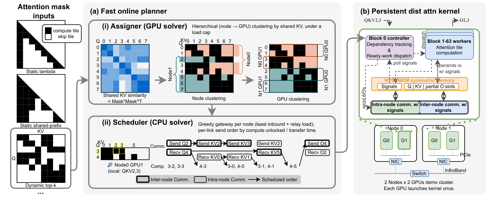
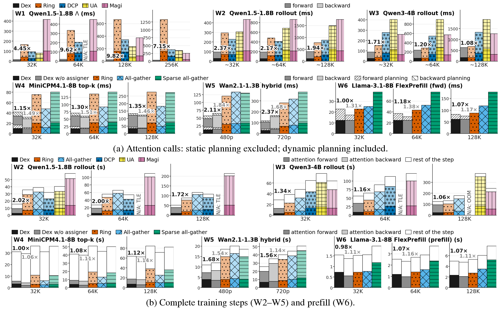

# DexAttention

Dex runs distributed sparse attention with masks that can change on every call. It combines GPU-accelerated assignment, CPU scheduling and a persistent GPU executor to reuse data, balance work and overlap communication with attention computation.

This repository implements **[DexAttention: Distributed Sparse Attention through Rapid Online Planning and Persistent GPU Execution](https://arxiv.org/abs/2611.23512)** ([PDF](https://arxiv.org/pdf/2611.23512)) and includes forward/backward kernels, six evaluation workloads, baseline adapters and reproduction scripts.

## How it works



1. **Assign work.** Cluster Q rows that share KV, then place them within load limits. When communication still dominates, redistribute KV columns across selected groups. Plan across nodes first, then across GPUs within each node.
2. **Schedule data and computation.** Receive shared remote inputs once per node and forward them locally. Order sends by compute gain per transfer cost, then prefer computation whose outputs must travel farther and whose inputs are expected earlier.
3. **Execute continuously.** A persistent kernel on each GPU dispatches ready attention tasks. Arrival signals release computation and forwarding; completed partial outputs return to their owners while other work continues.

The implementation uses PyTorch tensor operations and CUDA graphs for assignment, C++ for scheduling, and CUDA attention routines with NVSHMEM inter-node transfers and copy-engine intra-node transfers. See the [design](docs/design.md) for a short implementation guide.

## Get started

The core environment uses Python 3.11, PyTorch 2.5.1, CUDA 12.1, NVSHMEM 3.7.1 and NCCL 2.21.5. Building also requires libibverbs and libnuma development headers. The smoke test needs one node with four peer-accessible NVIDIA GPUs; multi-node execution needs InfiniBand with GPUDirect RDMA (`nvidia_peermem`).

```bash
bash third_party/setup_submodules.sh
cp config/env.example.sh config/env.sh
cp config/hostfile.example config/hostfile
# Edit config/env.sh for your paths, interfaces and environment;
# edit config/hostfile for your hosts.
pip install -r requirements/core.txt
bash build/build_ext.sh
bash tests/smoke_4gpu.sh
```

The smoke test runs a 16K input through Dex, Ring and All-gather, including forward, backward and an FP64 check. Configure machine paths through `config/env.sh`; generated data and results go under `$DEX_DATA_ROOT` and `$DEX_RESULT_ROOT`.

For W4–W6, use the workload-specific environments and extension builds in [reproduction](docs/reproduction.md). Dependency versions are pinned in [third_party/PINS.md](third_party/PINS.md); machine settings are documented in [config/env.example.sh](config/env.example.sh).

## Results

The paper evaluates four nodes with four RTX A5000 GPUs each, PCIe intra-node communication and one 200 Gb/s InfiniBand NIC per node.



- **Attention:** 4.45–9.82× speedup on the static Λ masks; 1.94–2.37× and 1.08–1.71× on the two rollout workloads, over the strongest applicable baseline in each group.
- **Training:** 1.39× geometric-mean end-to-end speedup across 11 configurations. Benefits depend on attention's share of the step; W4 gains are 1.00–1.12×.
- **Dynamic inference:** W6 prefill is 0.98–1.07× Ring's speed, including mask selection and planning.

These figures are from the paper, not regenerated results. Static attention timings exclude cached planning; dynamic timings include planning. The repository supplies experiment drivers and expected values; raw evaluation records are not bundled. Follow [reproduction](docs/reproduction.md) to generate records, figures and tables on your cluster.

## Code and documentation

- `dex/planner/`, `dex/scheduler/`: assignment and schedule construction.
- `csrc/`, `dex/attn/`: persistent kernels and attention interfaces.
- `workloads/`, `experiments/`, `analysis/`: inputs, experiments and result analysis.
- [Implementation guide](docs/design.md) · [Running the evaluation](docs/reproduction.md)

Licensed under [Apache-2.0](LICENSE). Dependencies retain their [own licenses](third_party/PINS.md).
